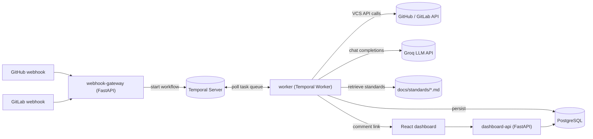
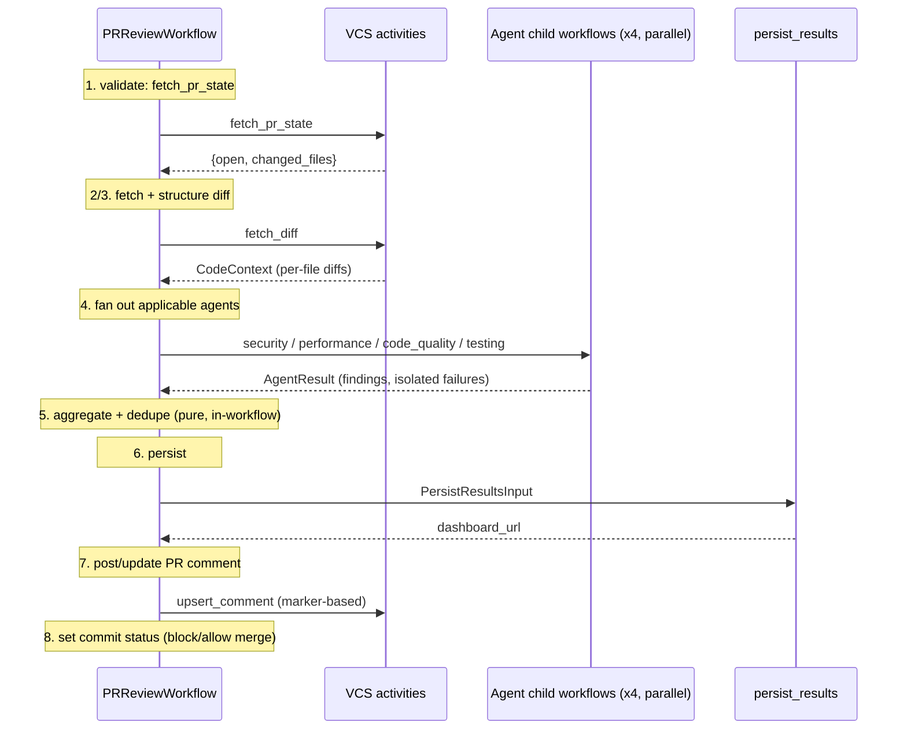
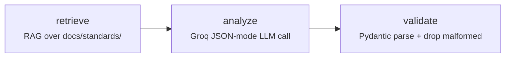

# Architecture

An automated PR/MR review platform: GitHub/GitLab webhooks trigger a Temporal workflow that
runs four specialized AI agents in parallel over the diff. Each agent is itself a small
**LangGraph** pipeline (retrieve → analyze → validate) that pulls relevant snippets from the
project's coding standards via a **RAG** retriever and produces structured, validated
findings. Results are aggregated, deduped, persisted, and posted back as a PR/MR comment,
with a React dashboard for deeper inspection.

## System overview



Four independent services, each a separate container:

| Service | Role |
|---|---|
| `webhook-gateway` | Verifies GitHub/GitLab webhook signatures, filters to relevant PR/MR events, starts `PRReviewWorkflow` |
| `worker` | Temporal worker: the workflow definition plus all activities (VCS calls, the 4 agents' LangGraph pipelines, persistence, comment posting) |
| `api` | Read-only FastAPI service the dashboard talks to |
| `frontend` | React/Vite dashboard |

`webhook-gateway` never imports worker code - it starts workflows by registered name
(`"PRReviewWorkflow"`), so the two can be deployed, scaled, and updated independently.

## Workflow: `PRReviewWorkflow`

One entity workflow per PR/MR; each pushed commit re-runs the review via a `new_commit`
signal, incrementing a round counter that the comment, dashboard, and diff logic reason
about ("round N vs round N-1"). The workflow ends when the PR/MR is closed.



Design choices worth calling out:

- **All I/O lives in activities; the workflow function is pure orchestration.** Which agents
  apply to which files is decided in the workflow (deterministic, input-derived); every HTTP
  call, LLM call, and DB write is an activity with its own `RetryPolicy`.
- **Aggregation and the comment template are pure functions called directly in the
  workflow**, not activities - they do no I/O, so wrapping them in an activity would only add
  latency and retry-policy overhead for no benefit.
- **No second LLM call for the summary comment.** It's deterministically templated from the
  aggregated counts (`comment_template.py`), which is cheaper, faster, and can't hallucinate
  numbers that don't match the findings.
- **Idempotent comments.** `upsert_comment` looks for a hidden marker
  (`<!-- ai-review-bot:{provider}:{pr_number} -->`) and edits that comment on re-runs instead
  of spamming a new one per push.
- **Isolated agent failures.** Agents run as parallel child workflows via
  `asyncio.gather(..., return_exceptions=True)`; one agent exhausting its retries doesn't
  fail the whole review - it just contributes zero findings with an `error` field for
  visibility.

## Agent design: LangGraph inside Temporal

Each of the four agents shares one `BaseReviewAgent` (`services/worker/app/agents/base.py`);
concrete agents supply only a category and system prompt. The actual per-agent pipeline is a
compiled **LangGraph** state graph (`services/worker/app/agents/graph.py`):



Why LangGraph *inside* a Temporal activity, rather than replacing Temporal?

- **Temporal** owns durable, cross-agent orchestration: parallel child workflows,
  independent retries, worker-restart survival, and a replayable audit trail of the whole
  review.
- **LangGraph** owns the *stateful, in-process* pipeline each individual agent runs
  through: fetch relevant coding-standards snippets, call the LLM, run a validator/repair
  pass over the structured output.

Effectively: LangGraph for the agent's reasoning loop, Temporal for durability and
orchestration between agents. The graph is compiled once per worker process and reused on
every agent invocation.

### The four agents

| Agent | Category | Focus |
|---|---|---|
| `SecurityReviewAgent` | `security` | Injection, secrets, auth, crypto, unsafe deserialization, OWASP |
| `PerformanceReviewAgent` | `performance` | N+1s, algorithmic complexity, memory, blocking I/O in async |
| `CodeQualityReviewAgent` | `code_quality` | API design, error handling, naming, maintainability, types |
| `TestingReviewAgent` | `testing` | Coverage of new code, weak assertions, edge cases, flake sources |

### Structured output and validation

The `validate` node parses the LLM's JSON response into `Finding` Pydantic models and drops
malformed entries with a warning rather than aborting. Anything that escapes this node is
guaranteed safe to persist, aggregate, and render - this is the "structured LLM responses
and validation" contract the platform makes to downstream consumers (dashboard, aggregation,
PR comment builder).

```python
class Finding(BaseModel):
    category: Literal["security", "performance", "code_quality", "testing"]
    severity: Literal["critical", "high", "medium", "low", "info"]
    file: str
    line_number: int | None
    issue: str
    explanation: str | None
    impact: str | None
    recommendation: str
    confidence: float
```

**Deduplication** (`aggregation.py`): findings from different agents that share file +
category + line and whose issue text is >60% similar (`difflib.SequenceMatcher`) are merged,
keeping the higher-severity / higher-confidence version.

## RAG over the coding-standards corpus

The `retrieve` node of every agent graph pulls from a small markdown corpus under
`docs/standards/` (`security.md`, `performance.md`, `code_quality.md`, `testing.md`). The
retriever (`services/worker/app/rag/retriever.py`) splits each doc at `##` headings, indexes
sections as token sets, and scores sections against a query built from the diff's added
lines + file paths. Top-k snippets are injected into the agent's user prompt as
"authoritative reference material" so the LLM cites project-specific rules rather than only
its priors.

This is deliberately **embedding-free**: the corpus is small, the query domain is narrow
(one category at a time), and the retrieval interface (`retrieve(query, k) -> list[Snippet]`)
is the same shape a vector-backed retriever would expose - so it can be swapped for
`chromadb` or `pgvector` later without touching the agents.

## VCS abstraction

`VCSClient` (`services/worker/app/vcs/base.py`) is implemented three ways:

- `GitHubClient` / `GitLabClient` - PAT-based, real API calls (`pulls/{n}/files`,
  `merge_requests/{iid}/changes`, issue/note comments).
- `MockVCSClient` - serves a fixed illustrative diff (a backend service change + a
  weak-assertion test) and logs comments instead of posting them. Selected via
  `VCS_MODE=mock`, this lets the entire pipeline (including real Groq calls and the
  LangGraph + RAG stack) run locally with zero repo write access - see
  `scripts/simulate_webhook.py`.

## Data model

Three Postgres tables (`libs/shared/pr_review_shared/models.py`): `repositories`,
`review_runs` (one row per workflow execution, with rollup `by_category`/`by_severity` JSON),
`findings` (one row per deduped finding). `Base.metadata.create_all` runs on worker/api
startup - no migration tool for the MVP (see Deferred below).

## Observability

- Temporal Web UI (`localhost:8088` in the compose stack) gives full workflow/activity
  history, retries, and failures for free - no separate tracing system needed to answer "what
  happened to this review."
- Structured `logging` configured per-service (`pr_review_shared/logging.py`); the
  `retrieve` node logs which standards snippets were pulled for each agent invocation.
- `/healthz` on both FastAPI services.

## Retry & failure handling

Every activity has an explicit `RetryPolicy` (exponential backoff, capped attempts). Agent
activities get a shorter/looser policy than VCS/DB activities since LLM 429s are the expected
failure mode on a free-tier key. A permanently-failed agent degrades the review (fewer
findings) rather than failing the whole workflow.

## Explicitly deferred (not stubbed with dead code)

These were scoped out of the MVP pass on purpose - noted here rather than left as
partially-built code:

- **Vector DB / embeddings-based context retrieval** - the current RAG layer is keyword-
  overlap over a small standards corpus, which fits the domain. Swapping to `chromadb` or
  `pgvector` becomes worthwhile when the corpus grows to full engineering-handbook size or
  we start indexing the target repository itself for cross-file convention checks.
- **Redis caching** - would cache LLM responses per diff-hash (useful when a workflow retries
  after a partial failure) and rate-limit Groq calls across concurrent workflows.
- **Kubernetes manifests** - the services are already 12-factor/stateless and horizontally
  scalable (the worker in particular just needs more replicas polling the same task queue);
  writing the actual Helm chart/manifests is follow-up work, not an architecture change.
- **GitHub App auth** - PAT auth is enough for MVP; a real multi-tenant deployment would use
  GitHub App installation tokens instead of a single PAT.
- **Alembic migrations** - `create_all` is fine until the schema needs a real migration.
